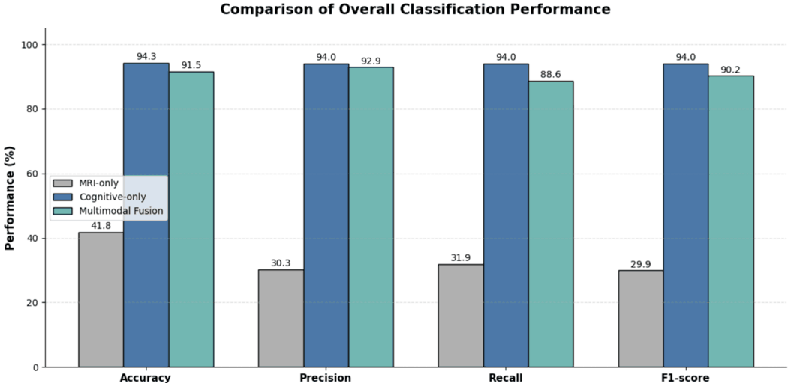
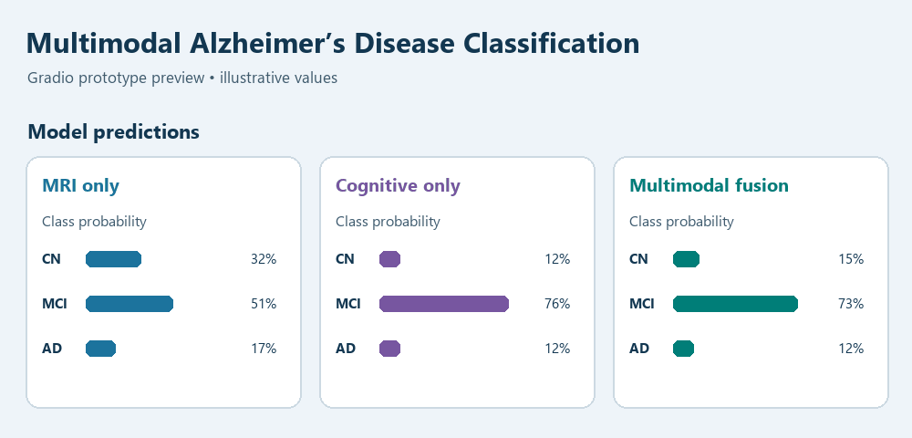

# AI Multimodal Dementia Detection

MSc dissertation project by Sara Khalid. I compared structural MRI, cognitive assessments, and late fusion for three-class dementia classification on matched ADNI data. I also evaluated 36-month progression from mild cognitive impairment (MCI) to Alzheimer’s disease and built a Gradio research prototype to present the three model outputs.

[Dissertation summary (PDF)](docs/dissertation_summary.pdf) · [Gradio app source](app/app.py) · [Model architecture](images/model_architecture.png)



| Model | Three-class accuracy | 36-month ROC-AUC |
| --- | ---: | ---: |
| MRI only | 41.84% | 0.567 |
| Cognitive only | 94.33% | 0.810 |
| Multimodal fusion | 91.49% | 0.813 |

Cognitive assessments led on three-class accuracy. Fusion slightly increased longitudinal ROC-AUC on the common 37-participant holdout, with the same accuracy as the cognitive model.

## Implementation

| Notebook | What it covers |
| --- | --- |
| [MRI preprocessing](notebooks/MRI_Preprocessing.ipynb) | Matches scans to metadata and resizes volumes for three-slice modelling. |
| [Cognitive data analysis](notebooks/Cognitive_Data_Analysis.ipynb) | Explores the matched cohort’s diagnosis distribution and cognitive features. |
| [MRI classification](notebooks/MRI_Classification.ipynb) | Evaluates a three-slice MobileNetV2 classifier. |
| [Cognitive classification](notebooks/Cognitive_Classification.ipynb) | Trains a Random Forest and compares it with XGBoost. |
| [Multimodal fusion](notebooks/Multimodal_Fusion.ipynb) | Combines MRI class probabilities with cognitive features. |
| [MCI progression prediction](notebooks/MCI_Progression_Prediction.ipynb) | Fits and evaluates a late-fusion rule using predictions from the separately trained 36-month models. |

The notebooks come from the original Colab implementation. Saved outputs were cleared and the Drive working path was changed to a generic project folder. The MRI preprocessing notebook uses a standard Drive mount cell.

## Gradio prototype



The app is adapted from the original Gradio notebook and starts a local server. With authorised inputs and model artifacts, install the dependencies and set the project root before launching:

```bash
python -m pip install -r requirements.txt
DEMENTIA_PROJECT_ROOT=/path/to/ADNI_Project python app/app.py
```

On PowerShell, set `$env:DEMENTIA_PROJECT_ROOT` before running `python app/app.py`. The project root should contain `Interface_Models/`, `Cognitive_Data/final_cognitive_702.csv`, and `MRI_Images/Processed_MRI_160/`. Use model artifacts from a trusted source. Reproducing the experiments also requires authorised ADNI data, intermediate cohort files, and the appropriate Colab runtime.

The prototype is for academic research and demonstration only. The interface preview uses illustrative probabilities.
